# Quick start guide

**NC Medicaid BH Operations Navigator, version 4.0**

This guide takes about 10 minutes. It shows you how to set up your plan, work through the checklist, read the instructions for each task, keep notes, and print your progress as a PDF.

> The screenshots use sample choices (Wake, Mecklenburg and Dare counties, and one checked task). Your screen will show your own choices.

## What the Navigator does

The Navigator is a checklist for starting a North Carolina behavioral health business that bills NC Medicaid for:

- **Peer Support Services** (CCP 8G)
- **SAIOP**, Substance Abuse Intensive Outpatient Program (CCP 8A-12)
- **SACOT**, Substance Abuse Comprehensive Outpatient Treatment (CCP 8A-13)

It has **31 steps and 116 tasks in six phases**, with instructions, tips, contacts and sources for every task. It tracks your progress, adds up the fees and weeks, shows the plan and hub contacts for your counties, and prints your plan.

> **Important.** The instructions came from a research pass that has **not** yet been checked against every official source. Each task has a **Check before relying on this** box that tells you how confident the research is and what to confirm. Before you spend money or sign anything, confirm the key facts with the agency named. This guide is not legal advice.

## Before you start

You need:
- A phone, tablet or computer with a current browser (Chrome, Edge, Safari or Firefox).
- The file `nc_medicaid_bh_dashboard.html`.
- No account, no password and no internet connection once the page has loaded.

**Your information stays on your device.** Nothing is sent anywhere. It is saved in your browser, so use **Export** (Step 9) to keep a backup, and do not type patient information into notes.

---

## Step 1. Open the Navigator

Open `nc_medicaid_bh_dashboard.html` in your browser. On a computer, double-click the file. On a phone, open it from your Files app or from the link you were given.

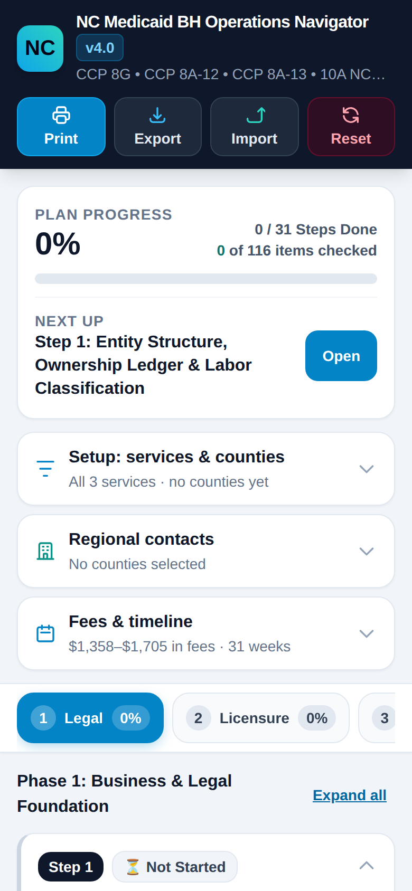

The first screen shows:

1. **Header buttons:** Print, Export, Import and Reset.
2. **Plan progress:** how much of your checklist is done.
3. **Next up:** the step to work on now. Tap **Open** to jump to it.

---

## Step 2. Choose your counties and services

Tap **Setup: services & counties** to open it.

### Pick your counties

Tap the county box. Search by name, tick the counties where you plan to operate, or tap **Toggle Region** to tick a whole region. **All 100** and **Clear** are shortcuts.

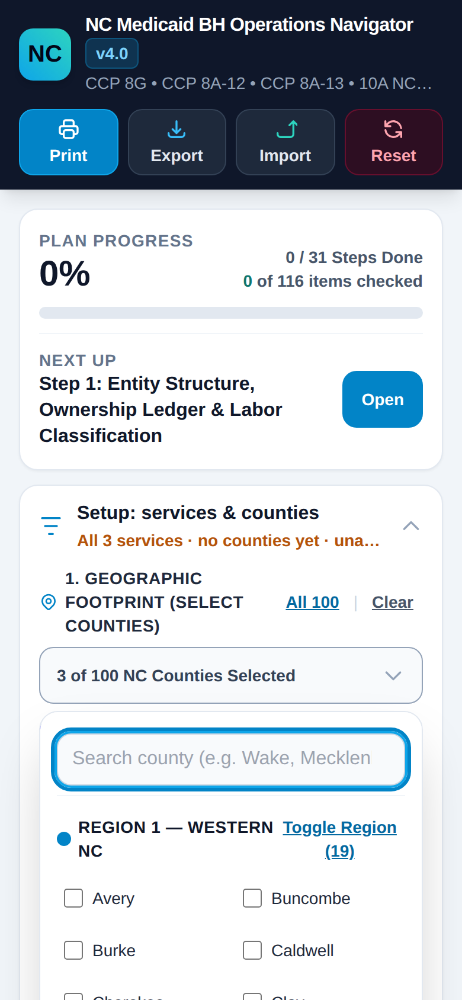

### Pick your services

Tap the services box and tick the services you plan to offer. Keep at least one. The checklist, fees and schedule change to match. For example, choosing **Only 8G** hides the DHSR licensing steps, because peer support does not need a DHSR license.

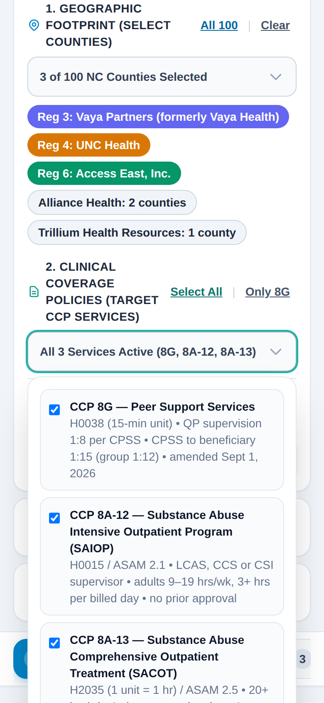

### Apply your choices

Your choices do not take effect until you tap **Apply Filters**. The yellow label **Unapplied Filter Changes** reminds you. Tap **Discard Changes** to go back.

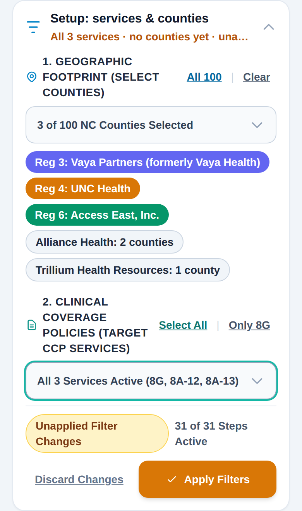

After you apply, a message confirms it and the panel closes.

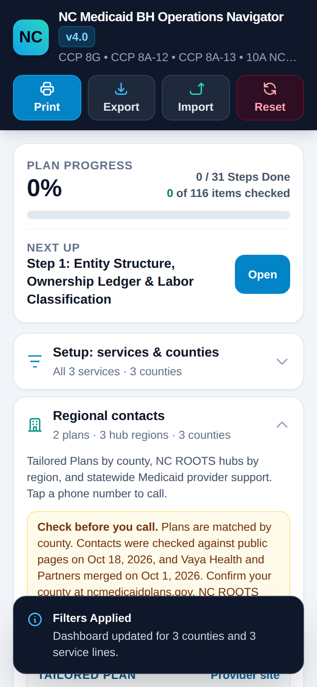

---

## Step 3. See who to contact in your counties

Open **Regional contacts**. It shows three groups:

- **Tailored Plans for your counties.** North Carolina assigns each county to one plan (Alliance Health, Trillium or Vaya Partners). Each card lists phone numbers, emails, the portal, the claims payer ID, and whether the plan is currently **taking applications** or has a **closed network** for peer support, SAIOP and SACOT.
- **NC ROOTS hub leads.** These are organized by region and handle rural health funding.
- **Statewide support.** The Provider Ombudsman, Medicaid Contact Center, NCTracks and NC HealthConnex.

Tap any phone number to call it, or any email to write to it.

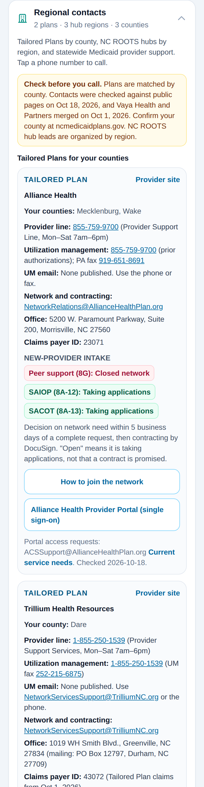

> **Read the notes on each card.** "Taking applications" means the plan is accepting applications, not that it promises a contract. Contacts were checked on October 18, 2026 and can change. The checklist file lists what to confirm.

---

## Step 4. Check fees and the schedule

Open **Fees & timeline**. The totals are worked out from your steps, so they change when you change your services.

- **Fees:** the government filing fees for your steps. Staff screening fees are shown separately, per person. Rent, build-out and salaries are not included.
- **Weeks:** how long the plan runs from the first step to the last.
- **Timeline:** a bar for each step. Tap a bar to open that step.

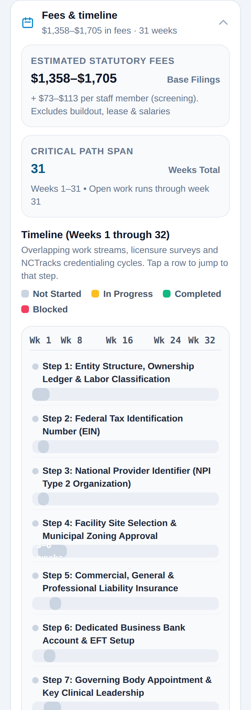

---

## Step 5. Work through the phases

Your plan has six phases, shown as tabs:

| Tab | Phase |
|---|---|
| 1 Legal | Business and legal foundation |
| 2 Licensure | DHSR licensure |
| 3 NCTracks & HIE | Medicaid enrollment and NC HealthConnex |
| 4 Contracts | Tailored Plan network contracts |
| 5 Launch | Operations and launch |
| 6 H.R. 1 | New federal Medicaid rules |

Swipe the tabs to see them all, then tap one. Each tab shows how much of that phase is done. The buttons at the bottom of a phase take you to the next or previous phase.

Tap a step to open it, or tap **Expand all** to open every step in the phase.

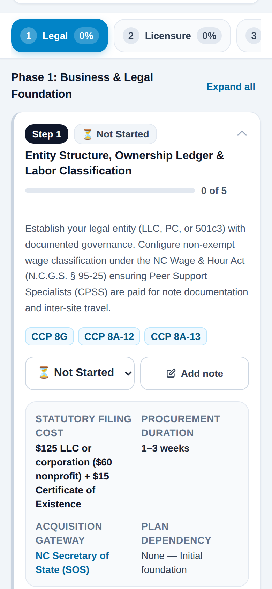

---

## Step 6. Check off tasks and set status

Inside an open step you will see:

- The **status** menu: Not Started, In Progress, Completed or Blocked.
- **Add note** for your own notes.
- The costs, time, who to contact and what the step depends on.
- The **checklist**.

**Tap anywhere on a task row to check it.** The step changes to **In Progress** after the first task and to **Completed** when every task is checked. If something is stuck, set the status to **Blocked** so it stays on your list.

Every task has an **Instructions** button.

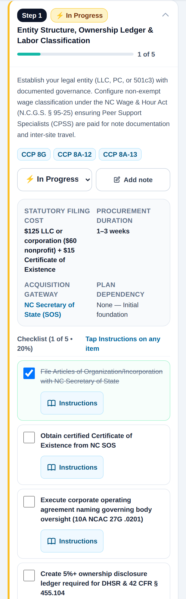

---

## Step 7. Read the instructions for a task

Tap **Instructions** on any task. A panel opens with:

1. **Step-by-step execution instructions.**
2. **Tips to avoid audit and licensing traps.**
3. **Required authority, portals and contacts** (tap phone numbers and emails).
4. **Check before relying on this.**

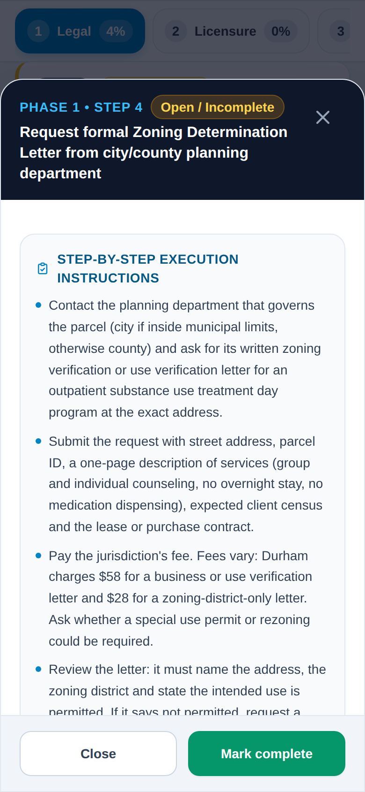

Scroll down to **Check before relying on this**. It shows:

- A **confidence rating** (high, medium, low, or "Not yet checked against sources").
- **Verify:** what you still need to confirm and with whom.
- **Sources:** links to the official pages the research used.

For the new federal rules in Phase 6, it also says whether an item is **required**, **expected** or **good practice**, and the date it starts.

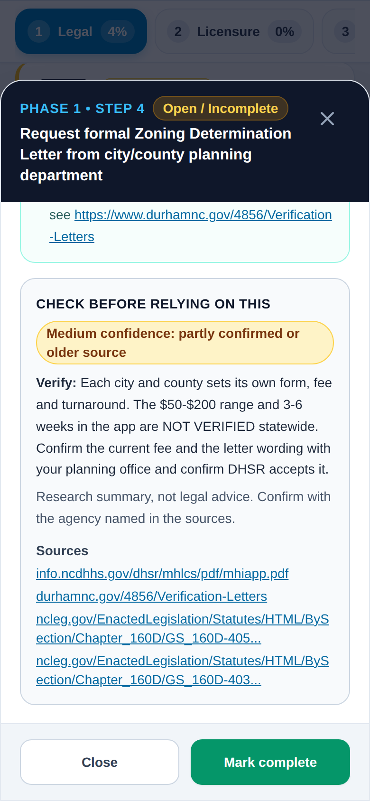

At the bottom, tap **Mark complete** (or **Mark incomplete**) to change the task, or **Close** to go back. Press **Esc** on a keyboard to close.

---

## Step 8. Keep notes

Tap **Add note** on a step to record what you did and when: who you spoke to, a confirmation number, a date. Notes are saved with your progress and appear in your printout. Tap **Save Notes**.

A step with a note shows **Edit note** instead.

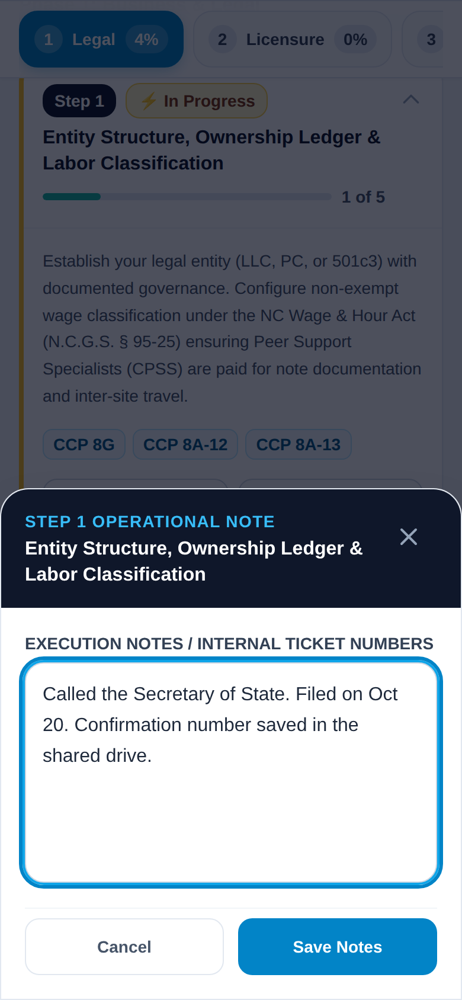

> Do not enter patient information or passwords in notes.

---

## Step 9. Save a backup, restore, or start over

These buttons are at the top of the page.

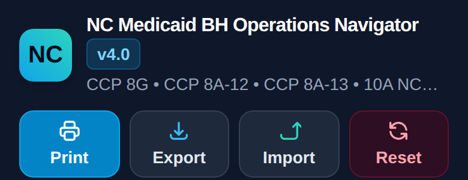

| Button | What it does |
|---|---|
| **Print** | Opens the print options (Step 10). |
| **Export** | Downloads a backup file named like `NC_Medicaid_BH_Navigator_Backup_2026-10-19.json`. |
| **Import** | Loads a backup file. Use it to move your progress to another device or browser. |
| **Reset** | Clears all progress, notes and choices. It asks you to confirm first. **Export before you reset.** |

Your progress saves automatically in your browser. If you clear your browser data, use a different browser, or open the file from a different location, it will look empty. That is why you should export a backup now and then.

---

## Step 10. Print your plan or save it as a PDF

Tap **Print**. Choose:

- **Entire plan**, or **Unfinished work only** (a to-do list that leaves out completed steps).
- Whether to include **Regional contacts**.

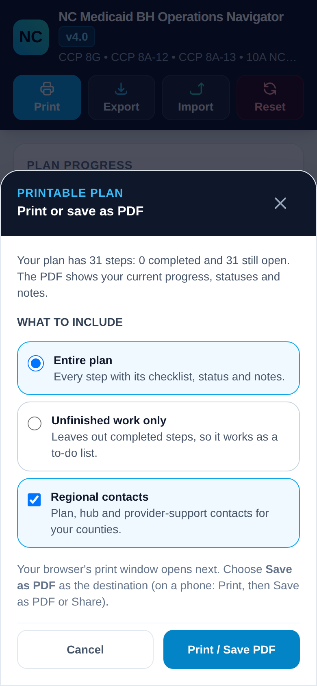

Tap **Print / Save PDF**. In your browser's print window, choose **Save as PDF** as the destination (on a phone: Print, then Save as PDF or Share). The file name starts with `NC_Medicaid_BH_Plan` and today's date.

The printout shows your progress, each step's status in words, drawn checkboxes, your notes, and your plan and hub contacts. For page numbers, print from Chrome or Edge.

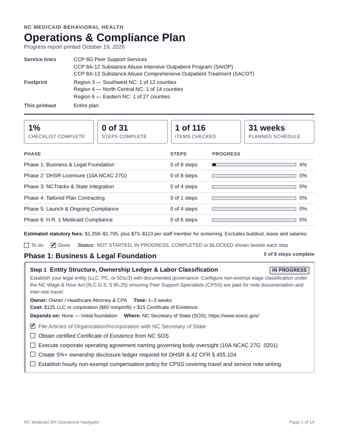

---

## On a computer

On a larger screen the same page shows more at once. Each phase opens with all its steps expanded, and the Setup panel opens the first time you visit.

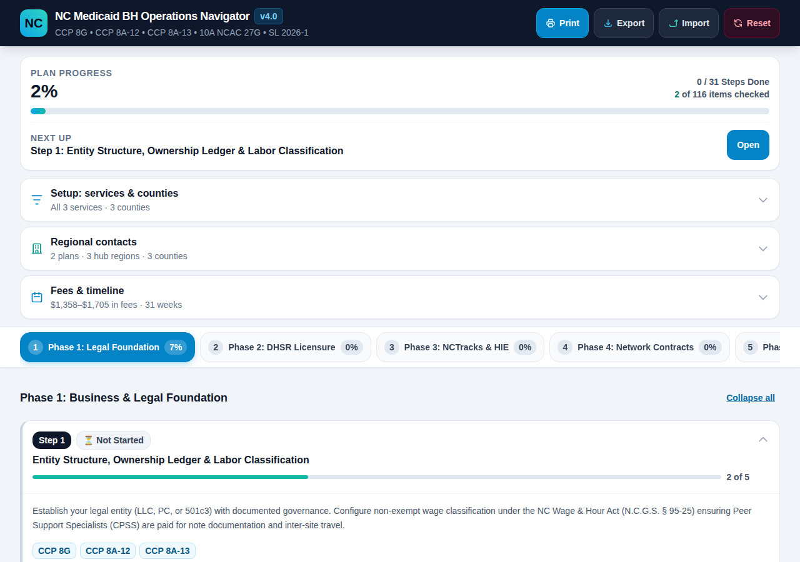

---

## Tips

- **Start with Step 1 in "Next up."** It always points to the first unfinished step.
- **Pick your services first.** Peer support alone has fewer steps than SAIOP and SACOT.
- **Write down the name and reference number** of everyone you call, in the step's note.
- **Verify before you pay.** Use the **Check before relying on this** box. The separate verification checklist has phone numbers and word-for-word scripts for the open questions.
- **Export once a week.** It takes one tap.

## Common questions

**My progress disappeared.** Progress is stored in your browser for this file. Opening the file in a different browser, from a different folder, in a private window, or after clearing browser data starts empty. Use **Import** to load your latest backup.

**Can two people use the same plan?** Not at the same time. Export from one device and import on the other. The most recent import replaces what is on that device.

**A step I expected is missing.** Steps are hidden when none of their services match your selection. Open **Setup** and tick more services, then **Apply Filters**. For example, the DHSR licensure steps (14 to 16) apply to SAIOP and SACOT only.

**The county I picked shows a different plan than I expected.** Plans are assigned by county. Confirm yours at ncmedicaidplans.gov or with the plan's provider line. Vaya Health and Partners merged on October 1, 2026.

**The printout has no page numbers.** Page numbers need Chrome or Edge.

**The text looks different or plain.** The page uses Google Fonts when it is online. Offline, it uses your device's standard font. Nothing else changes.

**I pressed Reset by mistake.** Tap **Import** and load your last backup. If you have no backup, the progress cannot be recovered.

**Is my information private?** Yes. Everything stays on your device. The page does not send your answers or notes anywhere.

## Getting help

- **Email the coaching team:** tap **Email the coaching team** in the top bar, or **Email the coaching team about this step** on any step. Your email app opens with the section and step already in the subject line. Send it to prn.guidance@adaptbridge.praxiomllc.com.
- **Find a task fast:** type in **Search steps and tasks**, or press `/` on a computer. Use **Show tasks for** to see only the steps owned by one role.
- **Calendar dates:** enter a **Plan start date** under Fees and timeline, then tap **Download calendar (.ics)** to add every step to your calendar.
- **What to confirm and who to call:** `NC_Medicaid_Verification_Checklist.md`
- **Where each fact came from:** `nc_medicaid_sources.csv`
- **How the app works (for developers):** `docs/SPECIFICATION.md`
